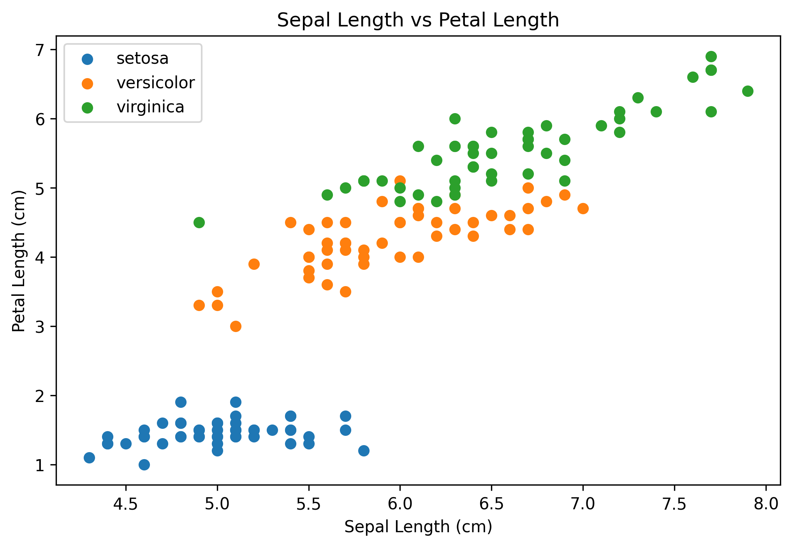
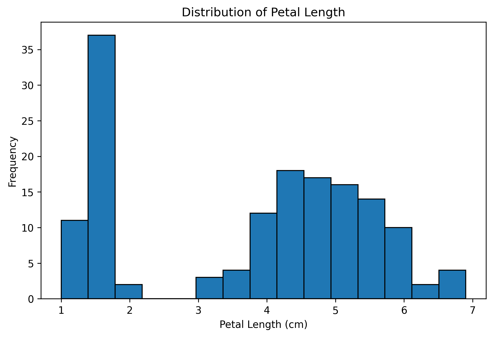
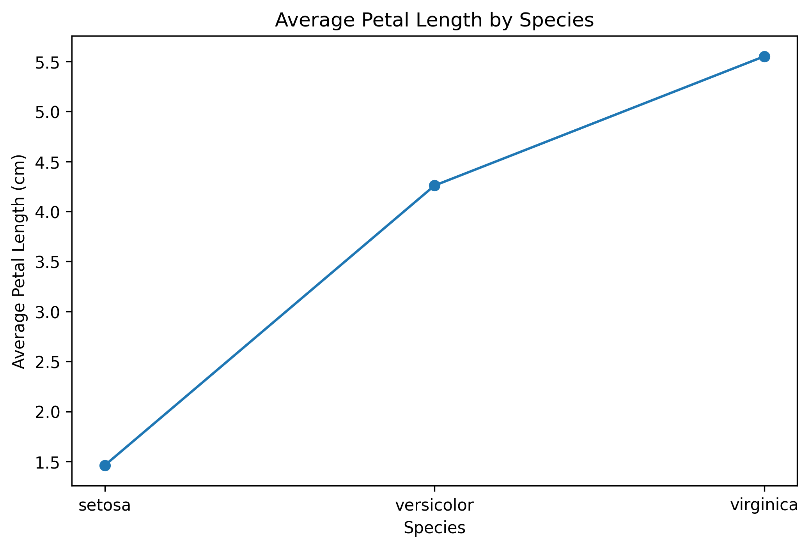

# r-data-visualization-internship
Data visualization project using R to analyze the Iris dataset through bar charts, scatter plots, histograms, and line charts.

## Visualizations

### 1. Bar Chart
Shows the number of flowers in each species.

### 2. Scatter Plot
Shows the relationship between sepal length and petal length.

### 3. Histogram
Shows the distribution of petal lengths.

### 4. Line Chart
Compares the average petal length across the three species.

